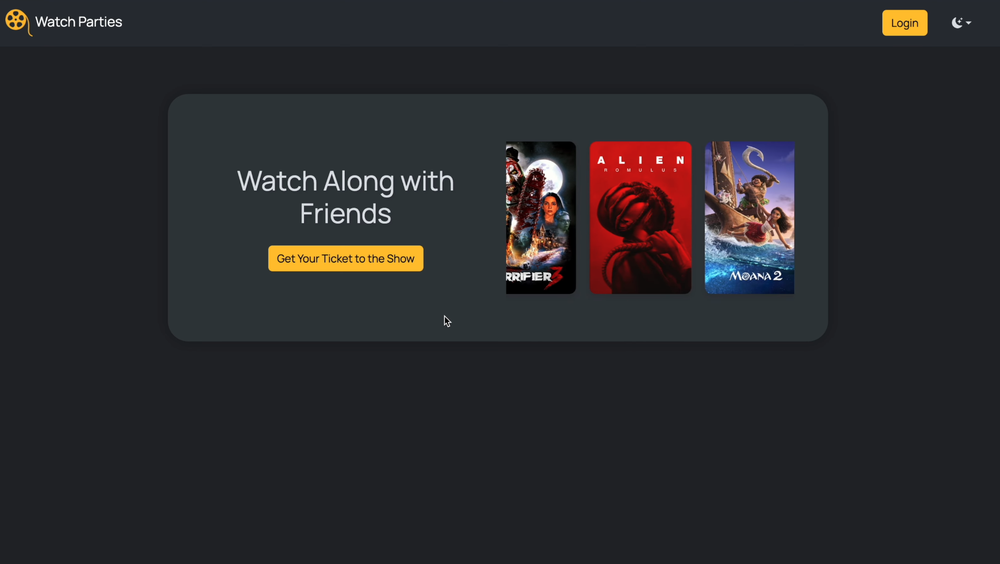
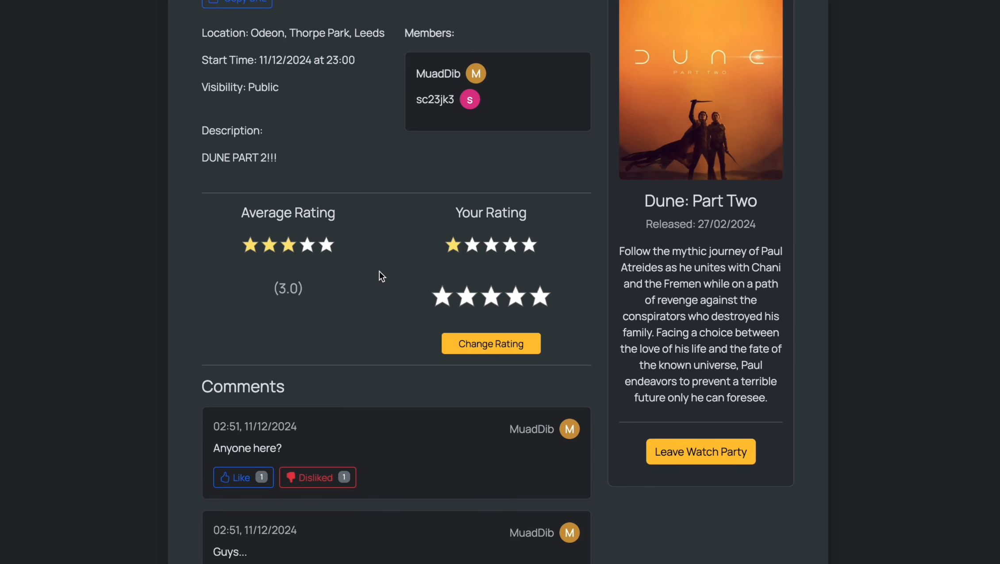

# Watch Parties

Watch Parties is a little social site for film lovers where you can create and join movie watch parties. Pick any movie (pulled straight from the TMDB API), set a time, date, and location (physical or virtual) and other users can join to signal that they want to watch it with you.





## Features

- **Create watch parties** - search for basically any film, add a title, description, location and start time, and choose whether it's public to everyone on the site or private and only accessible to people with the link.
- **Shareable private links** - every party gets a random UUID-based URL so no one can just stumble upon private parties by guessing IDs.
- **Join, leave, edit and delete** - owners can edit any detail of their party (including the film) or delete it, members can join and leave freely.
- **Ratings** - members can rate a watch party and the average updates on the fly without a page reload.
- **Comments** - leave comments on a party and like or dislike other people's comments asynchronously. The page even scrolls you back down to your comment after posting.
- **Live countdowns** - parties show how long until they start and the timer updates in real time.
- **Profiles** - change your username, email, password or profile colour, all submitted with AJAX.
- **Light and dark mode** - defaults to your system preference, but you can switch it and it's remembered across sessions.
- **Random posters** - the landing page has a rotating carousel of posters for highly rated films from the past couple of years.

## Tech Stack

- **Backend:** Python, Flask, Flask-SQLAlchemy, Flask-Login, Flask-WTF
- **Database:** SQLite
- **Frontend:** Jinja templates, Bootstrap, jQuery and vanilla JavaScript
- **External API:** [TMDB](https://www.themoviedb.org/) for all film data and posters

## Running Locally

1. Clone the repo and install the dependencies:

   ```bash
   git clone https://github.com/jkhwarazmi/watch-parties.git
   cd watch-parties
   python3 -m venv venv
   source venv/bin/activate
   pip install -r requirements.txt
   ```

2. Create a `.env` file in the root directory with your own secret key and a [TMDB API read access token](https://developer.themoviedb.org/docs/getting-started):

   ```
   SECRET_KEY=your-secret-key
   TMDB_KEY=your-tmdb-read-access-token
   ```

3. Run the app:

   ```bash
   python3 run.py
   ```

   And then head to `http://127.0.0.1:5000`.

The repo ships with `app.db`, a small SQLite database with a couple of demo users and parties so there's something to look at straight away.

## Future Improvements

- Email verification on sign-up, which would also allow password resets.
- Movie posters for every party on the homepage.
- Live-updating comments, more like a chat.
- Custom profile pictures instead of just colours.
- A personal watch list that could be used to recommend films to users.
